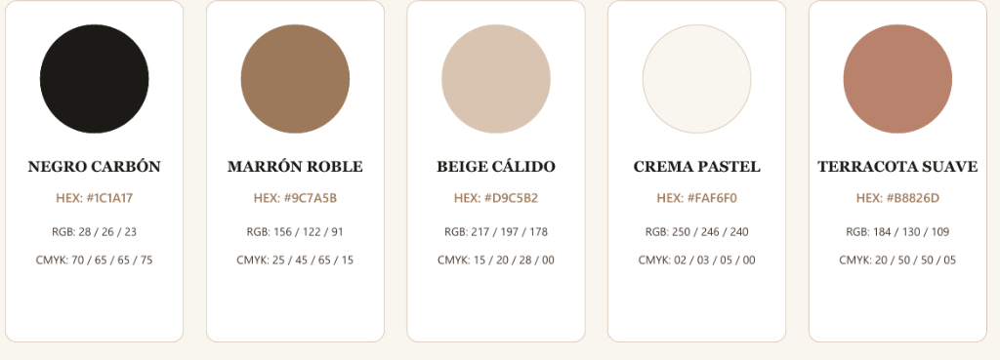

# Paleta de Colores Oficial — Clínica Vocal Cristina Iglesias

Esta paleta es la referencia visual predefinida e inmutable para el diseño, maquetación y desarrollo de Clínica Vocal. Debe utilizarse siempre como base y complemento en todos los elementos de la web.



---

## Valores cromáticos oficiales

| Muestra | Nombre | HEX | RGB | CMYK | Rol en la web |
| :--- | :--- | :--- | :--- | :--- | :--- |
|  | **Negro Carbón** | `#1C1A17` | `28, 26, 23` | `70, 65, 65, 75` | Textos principales, titulares, logotipo, iconos, botones primarios y contrastes oscuros. |
|  | **Marrón Roble** | `#9C7A5B` | `156, 122, 91` | `25, 45, 65, 15` | Acentos primarios, enlaces hover, bordes destacados, elementos activos, detalles cálidos. |
|  | **Beige Cálido** | `#D9C5B2` | `217, 197, 178` | `15, 20, 28, 0` | Fondos secundarios/secciones tintadas, líneas divisorias suaves, aros decorativos, tarjetas. |
|  | **Crema Pastel** | `#FAF6F0` | `250, 246, 240` | `2, 3, 5, 0` | Fondo general de la web (paper), tarjetas limpias, fondos luminosos y base general. |
|  | **Terracota Suave** | `#B8826D` | `184, 130, 109` | `20, 50, 50, 5` | Acento cálido complementario, badges, botones secundarios, llamadas de atención suaves. |

---

## Variables CSS (`:root`)

```css
:root {
  --color-negro: #1C1A17;
  --color-roble: #9C7A5B;
  --color-beige: #D9C5B2;
  --color-crema: #FAF6F0;
  --color-terracota: #B8826D;

  /* Asignaciones funcionales */
  --paper: var(--color-crema);        /* #FAF6F0 Fondo base */
  --ink: var(--color-negro);           /* #1C1A17 Texto y elementos oscuros */
  --line: #E5DCD3;                    /* Línea sutil derivada de beige */
  --muted: #5C554E;                   /* Texto secundario cálido */
  --accent: var(--color-roble);       /* #9C7A5B Acento principal */
  --accent-alt: var(--color-terracota);/* #B8826D Acento complementario */
  --tint: #F3ECE2;                    /* Fondo suave para secciones */
}
```
